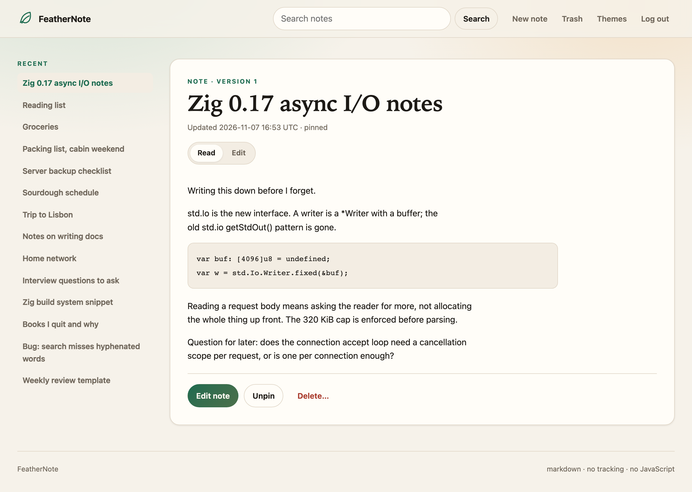
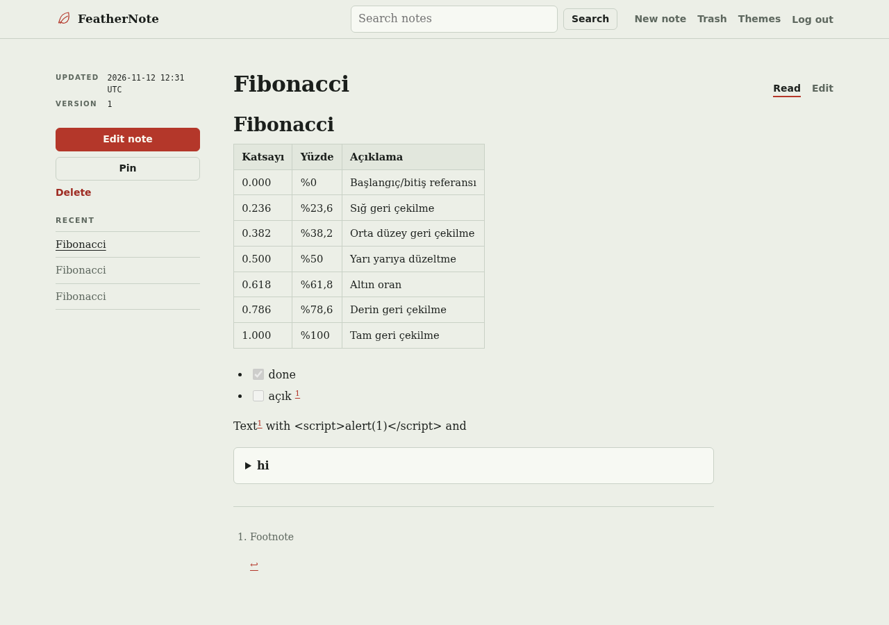
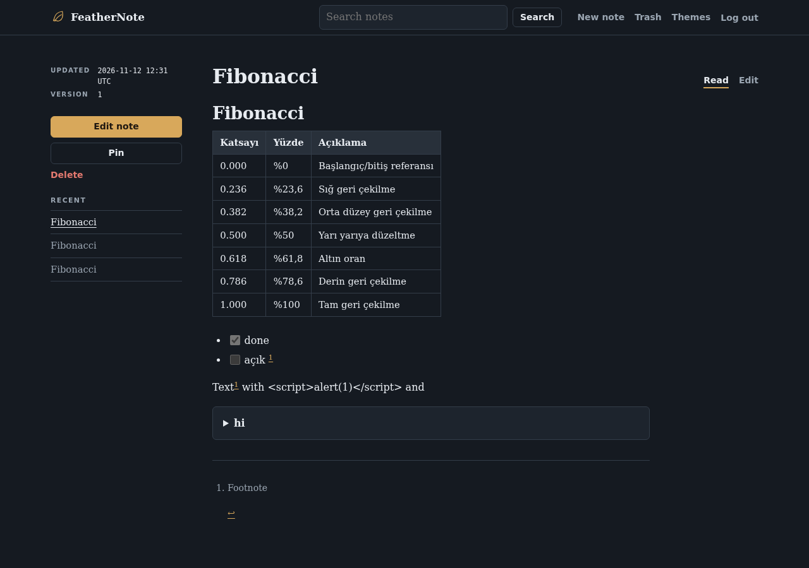
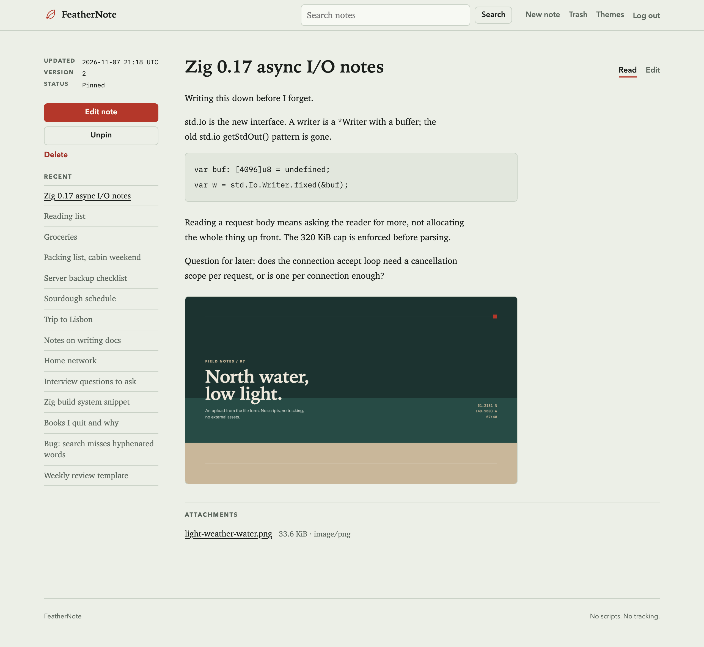
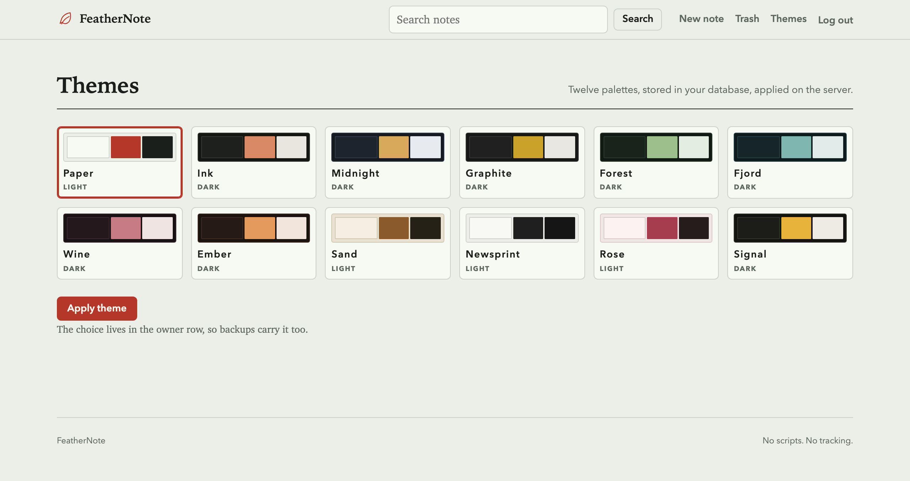
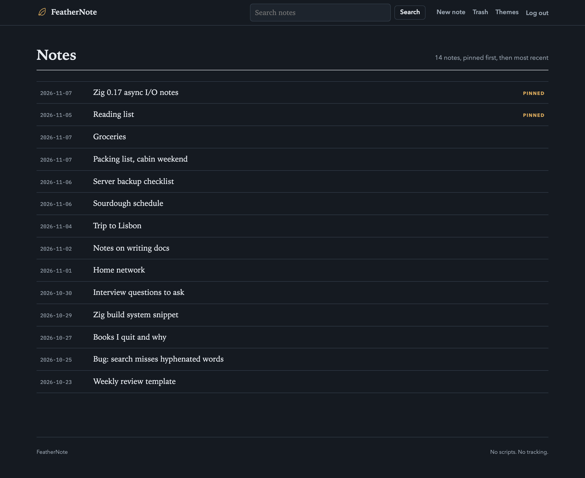

# FeatherNote

**A quiet, single-owner notebook: Markdown, twelve themes, file attachments, and zero JavaScript.**

[](https://ziglang.org/download/)


FeatherNote is a self-hosted notes app for exactly one person. A small Zig
process serves plain HTML, every note lives in a single SQLite database, and
everything works with JavaScript turned off. You log in with one password, then
read, write Markdown, search, pin, attach files, delete, and restore. There is
no registration, no sharing, no sync service, and no tracking.

It is meant for the case where you want your notes on a cheap VPS, you want
backups to be one file, and you want to understand the whole thing in an
afternoon.

| | |
|---|---|
| Runtime | Zig 0.17.1, one process |
| Storage | SQLite 3.54.1, one file, WAL with `synchronous=FULL` |
| UI | Server-rendered HTML, embedded CSS, 12 themes |
| JavaScript | none required, none served |
| Writing | Markdown source, server-rendered read view |
| Files | image, PDF, text, and archive attachments up to 8 MiB |
| Auth | one owner, Argon2id, server-side sessions |
| Search | SQLite FTS5, quoted phrase terms |
| Public port | never. FeatherNote binds loopback and sits behind a TLS proxy |

## A quick tour

### Read first, then edit

Opening a note shows the rendered Markdown, not a text box. The Read and Edit
tabs are ordinary links, so the whole flow works without scripting. Recent
notes stay in a sidebar on desktop.



### Write in Markdown

The editor is a plain textarea plus a cheatsheet. Headings, emphasis, lists,
quotes, fenced and indented code, links, images, tables, task lists,
strikethrough, footnotes, and autolinks are rendered on the server by MD4C
(CommonMark + GFM). A safe subset of raw HTML is rendered after allowlist
sanitization; active content such as scripts, event handlers, iframes, and
dangerous URLs is never executed.






### Attach images and files

The editor's file form uploads an image or document, stores it in the same
SQLite file, and appends a Markdown link to the end of the note. Images render
inline in the read view. Other types download as attachments.

Pasting an image from the clipboard, or dragging a file onto the page, requires
JavaScript. FeatherNote does not do that. Use the file picker instead.



### Search

Search runs over titles and bodies with FTS5. Input is split into words, each
word is quoted, and the words are joined with `AND`, so it stays a search box
and never becomes a query language. On the benchmark machine, a 10,000 note
search had a p95 of 4.2 ms.


### Twelve themes, including dark mode

Themes are stored in the owner row, so the choice follows you across devices
and travels inside backups. Eight are dark, four are light. The picker is a
form with radio cards, and the swatches preview each palette.





### Trash

Deleted notes wait in Trash until an operator removes them. Restore puts a
note back in the list with a new version.


### Log in

One password, no registration, no account recovery through email. If you lose
the password, a local operator resets it and revokes every session.


### Starting a new note

The composer is a title and a Markdown text box. Save once before attaching
files. No toolbar, no block editor, no autosave race.


### On a phone

No app, no separate mobile site, no JavaScript. The same server-rendered pages
reflow to one column.


### When two tabs disagree

Every save carries the version it started from. If the note changed in another
tab, FeatherNote returns **409** and shows your complete draft beside the
latest saved version. Nothing is overwritten silently. Saving your draft over
the latest version is a separate, explicit click.


## Run it locally

You need Zig **0.17.1** and nothing else. SQLite is vendored, so there is no
system SQLite dependency.

```sh
git clone https://github.com/ddawnlll/FeatherNote.git
cd FeatherNote

zig build --release=safe

mkdir -p data
printf '%s\n' 'a long owner password' | \
  ./zig-out/bin/feathernote admin set-password --db data/feathernote.db

./zig-out/bin/feathernote serve \
  --db data/feathernote.db \
  --listen 127.0.0.1:8080 \
  --insecure-cookies
```

Open <http://127.0.0.1:8080/>.

`--insecure-cookies` exists only for plain-HTTP local testing. The production
default uses a `__Host-` cookie and requires HTTPS.

FeatherNote has been built and run on macOS (aarch64) and Linux x86_64. Other
Zig targets should work but are untested.

Configuration can also come from the environment:

| Variable | Default | Purpose |
|---|---|---|
| `FEATHERNOTE_DB` | `data/feathernote.db` | database path |
| `FEATHERNOTE_LISTEN` | `127.0.0.1:8080` | `host:port` |
| `FEATHERNOTE_INSECURE_COOKIES` | `0` | local HTTP only |
| `FEATHERNOTE_TRUST_PROXY` | `0` | trust `X-Real-IP` from the local proxy |
| `FEATHERNOTE_SESSION_DAYS` | `30` | absolute session lifetime, 1 to 365 |
| `FEATHERNOTE_ALLOW_PUBLIC_BIND` | `0` | allow a non-loopback bind |

Flags override environment values. The full list is available with
`feathernote --help`.

## Use it from an MCP client

The same binary is a local stdio MCP server, so Claude, Cursor, Codex, or any
other MCP client can read and write notes. It is read-only unless you opt in:

```sh
feathernote mcp --db data/feathernote.db --allow-write
```

It exposes 17 tools, including search, read, create, append, pin, delete,
restore, base64 attachments, and theme control, plus
`feathernote://notes/{id}` resources. Writes require the note version, so a
stale update returns a conflict with the latest note instead of overwriting it.
There is no listener and no token. Client configuration, tool reference, and
security notes are in [`docs/MCP.md`](docs/MCP.md).

## How it is put together

- **One process, one database connection.** A mutex serializes access, which
  keeps memory predictable for a single owner. At most 64 connections are
  admitted at once.
- **Durability first.** WAL mode with `synchronous=FULL`. A successful save is
  committed and synced before the response is sent.
- **Optimistic concurrency.** Each note has a version. A stale save gets a 409
  and both versions, never a silent overwrite.
- **Safe Markdown.** Notes are rendered by the vendored MD4C 0.5.3 parser
  (CommonMark + GitHub dialect: tables, task lists, strikethrough, autolinks)
  followed by an allowlist HTML sanitizer. Links allow http(s), mailto,
  same-origin paths, and `#` fragments; images allow same-origin paths only;
  scripts, event handlers, styles, iframes, SVG/MathML, and unsafe schemes
  never reach the browser. Footnotes are a FeatherNote extension. See
  [`src/markdown.zig`](src/markdown.zig), [`vendor/md4c/VENDOR.md`](vendor/md4c/VENDOR.md),
  and decision D019 in [`docs/DECISIONS.md`](docs/DECISIONS.md).
- **Attachments in SQLite.** Uploads are parsed as multipart, size-capped at
  8 MiB, MIME-sniffed from the bytes, and stored as BLOBs. Images are served
  inline. Everything else, including SVG and HTML, is served as a download
  with `nosniff`. See [`src/multipart.zig`](src/multipart.zig).
- **Server-side themes.** The selected theme is a validated id in the owner
  row. Every page emits it as `data-theme`, and one embedded stylesheet carries
  all twelve palettes. Swapping themes costs one form post and one cached
  stylesheet.
- **One design system.** The editorial ledger direction, tokens, type, and
  motion rules live in [`DESIGN.md`](DESIGN.md). The default palette is cool
  paper with a vermilion accent; the index is ruled, not a card grid.
- **CSS-only page transitions.** Cross-document View Transitions animate page
  changes with transform and opacity, leaving the header fixed. Nothing is
  scripted, and reduced-motion turns it off.
- **Local MCP server.** One stdio subcommand reuses the same schema, FTS
  search, version checks, and attachment validation as the web app. It binds
  no port and defaults to read-only.
- **CSRF on every authenticated mutation**, including logout, theme changes,
  uploads, and file deletion. Login is rate limited and runs a full Argon2id
  verification.
- **Escaped output everywhere**, including `</textarea>`. The CSP is
  `default-src 'none'` with only local styles and same-origin images allowed.
- **Embedded assets.** The stylesheet and migrations are compiled into the
  binary, so the executable has no runtime asset paths.
- **FTS5 search** through an external-content index with triggers, so note
  bodies are stored once.

The schema is three migrations in [`migrations/`](migrations/). The design
tradeoffs are recorded in [`docs/DECISIONS.md`](docs/DECISIONS.md).

## Deploying behind TLS

FeatherNote never implements TLS. It binds loopback and expects a reverse proxy
to own certificates, HSTS, request size ceilings, and the public listener.

1. Build and install the binary somewhere like `/usr/local/bin/feathernote`.
2. Create a service account and data directory, then set the owner password
   with `feathernote admin set-password`.
3. Install [`deploy/feathernote.service`](deploy/feathernote.service) and
   enable it.
4. Put nginx or Caddy in front, using [`deploy/nginx.conf`](deploy/nginx.conf)
   as a starting point. Keep `proxy_pass http://127.0.0.1:8080` and start the
   app with `--trust-proxy`.

If attachments matter, raise the proxy's request-body limit above 8 MiB while
keeping it finite. The app enforces its own cap regardless.

The step by step version, including systemd user units, DuckDNS, and Let's
Encrypt renewal, is in [`docs/DEPLOYMENT.md`](docs/DEPLOYMENT.md).

## Backup and restore

Use the online backup command. Do not copy a live WAL database with `cp`.

```sh
feathernote admin backup --db /var/lib/feathernote/feathernote.db \
  --out /var/backups/feathernote/daily/pre-update.db
```

The command runs `PRAGMA integrity_check` on the destination before reporting
success. Because attachments and the selected theme live in SQLite, a backup
carries notes, files, and appearance together.
[`scripts/backup.sh`](scripts/backup.sh) adds 7 daily and 4 weekly retention.
[`scripts/restore.sh`](scripts/restore.sh) refuses to overwrite an existing
database, verifies the backup, and swaps it into place with the service
stopped.

Backups that leave the host should be encrypted with a key you manage
separately. FeatherNote does not claim end-to-end encryption, because the
server reads plaintext.

## Tests and measurements

```sh
zig build test                 # unit tests: Markdown, multipart, CRUD, search
python3 tests/integration.py   # 88 real HTTP checks, no JavaScript
python3 tests/mcp_test.py      # 46 stdio MCP protocol checks
python3 scripts/bench.py --requests 200 --counts 100,10000
```

The integration suite drives the compiled server over TCP and covers login,
unauthorized access, every note operation, Markdown rendering and escaping,
theme selection and CSRF, image upload and inline delivery, SVG served as a
download, attachment deletion, 409 draft preservation, CSRF, XSS and
`</textarea>` escaping, SQL injection in search and login, invalid UTF-8,
oversized bodies, disallowed methods, logout revocation, restart persistence,
survival of an acknowledged write after `SIGKILL`, an online backup taken while
40 concurrent saves are in flight, restore into a fresh directory, security
headers, and the absence of secrets in logs.

Benchmarks are measured, not estimated. On the recorded Debian 13 machine
(ReleaseSafe, loopback, 1 KiB notes):

| Metric | Measured |
|---|---|
| Idle RSS | 6.0 to 6.6 MiB |
| Peak RSS during Argon2id login | 23.4 MiB |
| Warm note GET p95 | 1.1 to 3.2 ms |
| Save POST p95 | 9.1 to 10.6 ms |
| 10,000 note FTS search p95 | 4.2 ms |

Commands, percentiles, machine details, and the items that remain UNVERIFIED
are in [`reports/benchmarks.md`](reports/benchmarks.md), with raw JSON in
[`reports/benchmarks-raw.json`](reports/benchmarks-raw.json). These numbers are
from one machine and are not a universal claim. The stylesheet is now 22.5 KiB
because it carries twelve palettes; the original 3 KiB figure applied to the
single-theme P0 UI and is recorded in the report.

## Reproducing the screenshots

Every screenshot above was captured from a real running instance with
Playwright, with **JavaScript disabled in the browser context**. The demo notes
and capture script are in the repository:

- [`scripts/demo-notes.py`](scripts/demo-notes.py) inserts a small set of
  realistic notes into a fresh database.
- [`scripts/capture-screenshots.js`](scripts/capture-screenshots.js) logs in,
  visits each page, uploads a generated demo image, triggers a real edit
  conflict, and writes the images into `docs/screenshots/`.

To reproduce them on a scratch database, run the server in one terminal:

```sh
printf '%s\n' 'demo password' | \
  ./zig-out/bin/feathernote admin set-password --db data/demo.db
python3 scripts/demo-notes.py data/demo.db
./zig-out/bin/feathernote serve --db data/demo.db \
  --listen 127.0.0.1:8090 --insecure-cookies
```

Then, in a second terminal (Node 18 or newer), capture the images:

```sh
npm install
npx playwright install chromium
FEATHERNOTE_URL=http://127.0.0.1:8090 \
FEATHERNOTE_PASSWORD='demo password' \
  npm run --silent screenshots
```

The demo password above and the default in the script are for throwaway local
data only. The script leaves the instance on the Paper theme.

## Repository layout

```
DESIGN.md       design system, tokens, motion rules, and slop audit
src/            server, routes, SQLite layer, auth, HTML views
src/markdown.zig  safe Markdown renderer
src/multipart.zig bounded multipart/form-data parser
src/themes.zig     the twelve theme ids
src/mcp.zig       stdio MCP server
src/media.zig     shared attachment sniffing and naming
assets.zig      build-time embedding of CSS and migrations
web/style.css   the entire stylesheet, all twelve themes
migrations/     versioned SQL schema
tests/          integration and adversarial HTTP suite
scripts/        backup, restore, seed, benchmark, demo data, screenshots
deploy/         systemd units and nginx examples
docs/           deployment guide, MCP guide, decision log, screenshots
reports/        measured benchmark evidence
vendor/sqlite/  pinned SQLite 3.54.1 amalgamation with checksums
```

## Limits and honest non-goals

- One owner. No sharing, no teams, no public registration.
- No password reset flow. A local operator runs
  `feathernote admin set-password`, which revokes all sessions.
- Notes and attachments are plaintext on the server. Anyone who can read the
  database or its backups can read both.
- No JavaScript means no paste-to-upload, drag and drop, live preview, or
  keyboard shortcuts. Upload through the file form, then save.
- Markdown is a deliberate subset. No tables, footnotes, task lists, or raw
  HTML. Unsupported syntax degrades to text.
- Attachments are capped at 8 MiB each and stored inside SQLite, so backups
  grow with them. There are no thumbnails or image transcoding.
- Search is word matching, not a query language.
- No purge UI. Deleted notes stay in Trash until an operator removes them.
- No background worker, polling loop, websocket, or sync protocol.
- No graceful-shutdown handler. `SIGTERM` is safe because WAL plus
  `synchronous=FULL` keeps acknowledged writes.
- Revisions and diffs are future work. The 409 flow preserves drafts today.

## License

No license file is included yet. Add one before redistributing binaries or
hosting this for anyone other than yourself.
