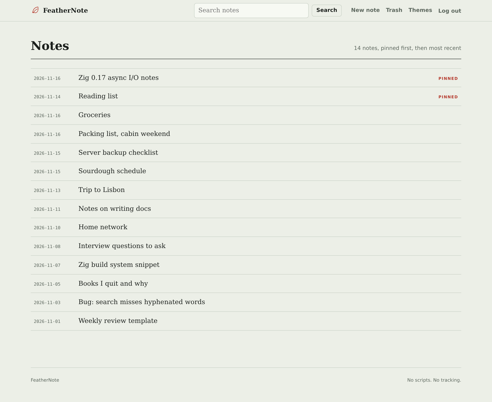
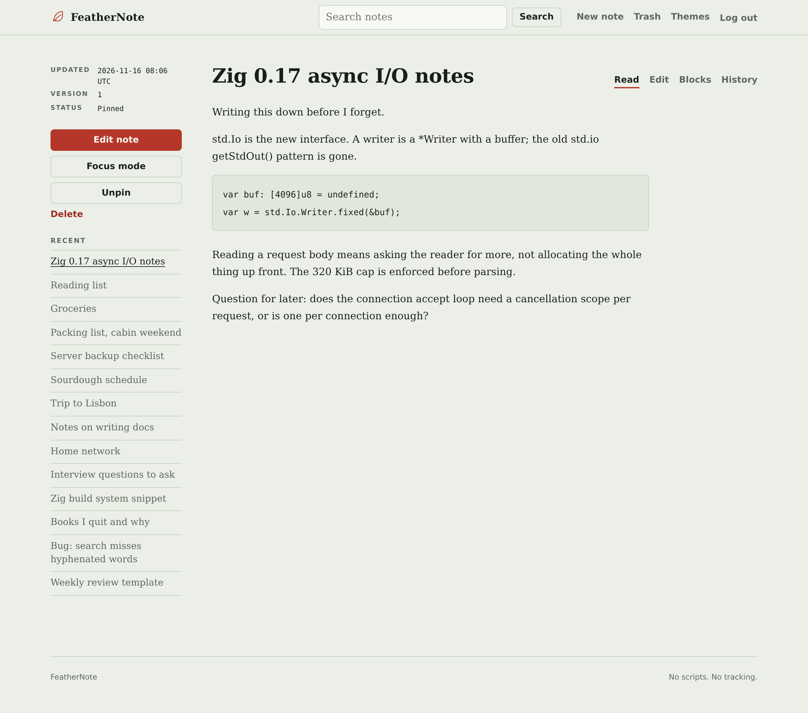
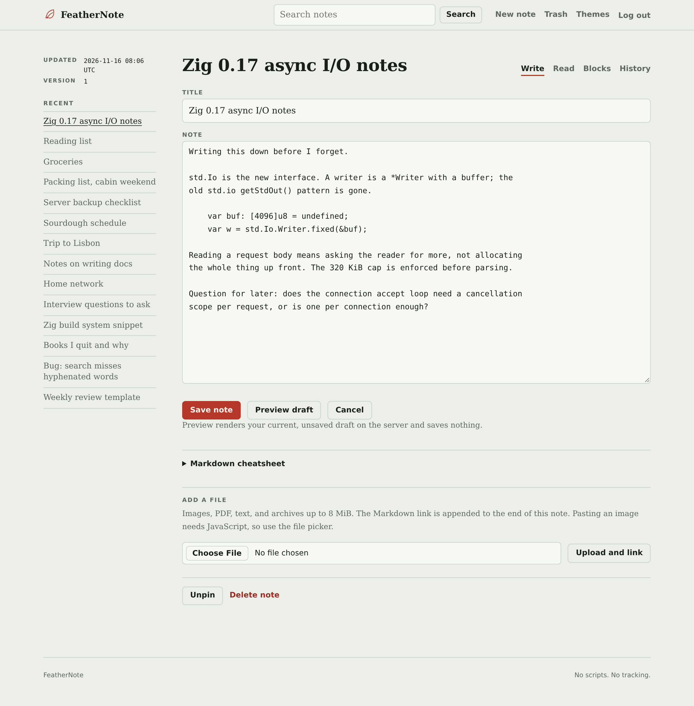
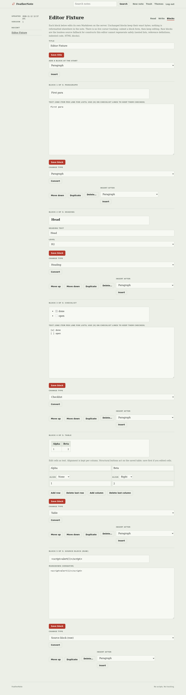
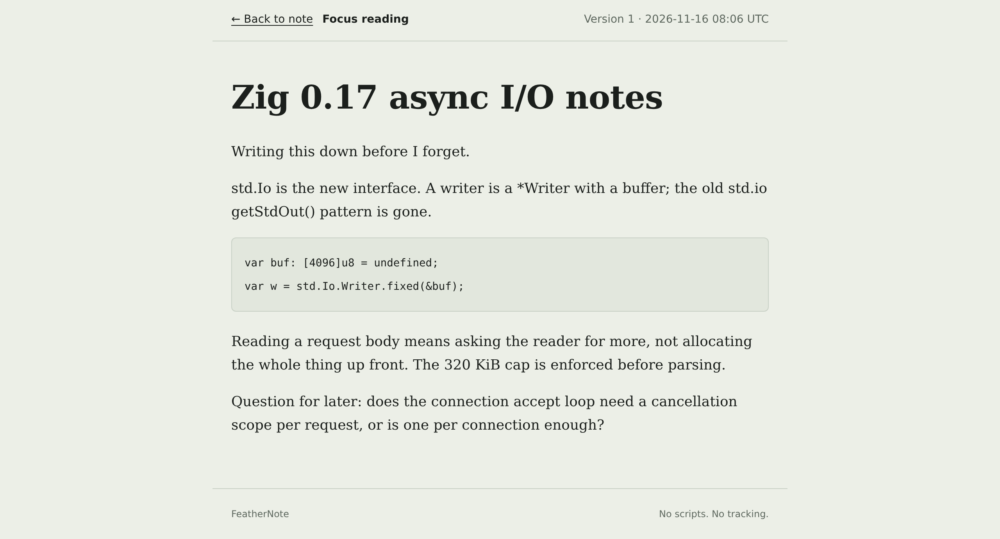
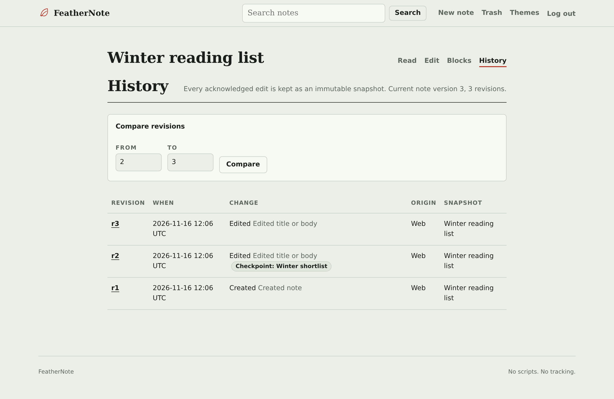
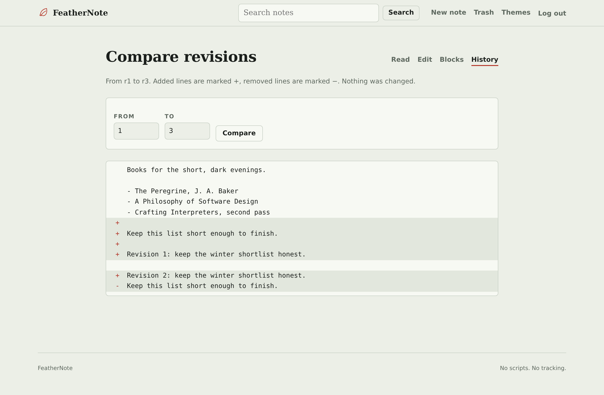
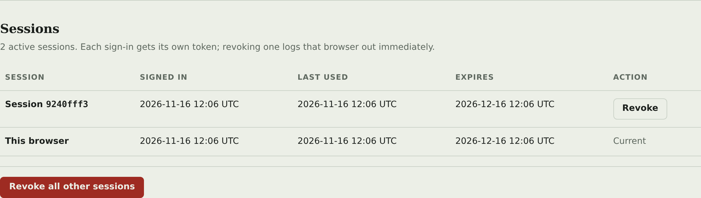
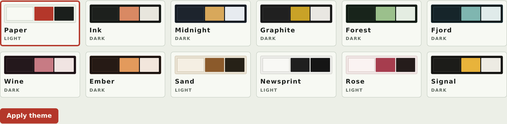
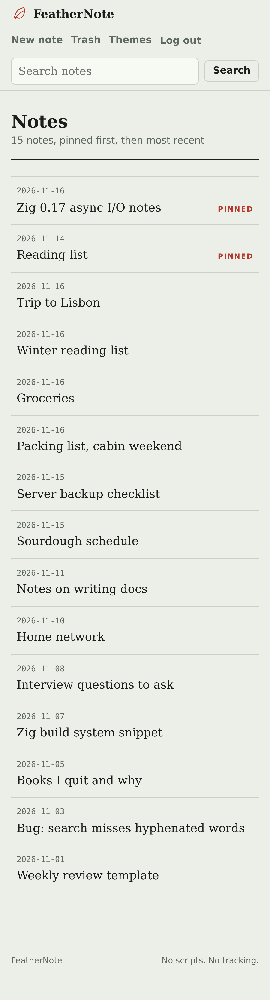

# FeatherNote

**A private notebook you own.**

FeatherNote is a self-hosted notes app for exactly one person. It renders every
page on the server, keeps your notes and files in one SQLite database, and asks
nothing of the browser beyond HTML and CSS.

No registration. No tracking. No client JavaScript.

[Visit the website](https://ddawnlll.github.io/FeatherNote/) · [Read the source](https://github.com/ddawnlll/FeatherNote)

<p align="center">
  
</p>

## Why it feels different

- **Quiet by design.** A ruled index, an editorial reading column, and twelve
  considered themes. No dashboards, badges, or engagement loops.
- **No JavaScript at all.** Read, write, search, attach files, edit in blocks,
  and review history with JavaScript disabled. The app serves zero bytes of it.
- **History is kept by default.** Every meaningful save becomes an immutable
  revision. Compare any two, label important checkpoints, and restore without
  rewriting the past.
- **One file to back up.** Notes, files, revisions, sessions, and the selected
  theme live together in SQLite. Backups are verified before they are trusted.
- **Small enough to own.** One Zig binary, no external services, no runtime
  assets, and a loopback listener behind your TLS proxy.

## Write the way you think

### Markdown, rendered properly

Read view is the default. Headings, lists, quotes, code, tables, task lists,
footnotes, and links are rendered on the server by MD4C, then passed through an
allowlist sanitizer. Active content never reaches the page.

| Read | Edit |
|:--:|:--:|
| [](docs/screenshots/note-read.png) | [](docs/screenshots/note-editor.png) |
| Rendered Markdown, tables, and code. | Plain Markdown source with a preview that saves nothing. |

### A block editor without scripting

The Blocks tab edits the same Markdown one block at a time: paragraphs,
headings, lists, checklists, quotes, code, tables, links, and images. Unchanged
blocks keep their exact bytes. The source editor is always one tab away.

<p align="center">
  
</p>

### Focus reading

One note, one centered column, and nothing else. Focus mode uses the same
server-rendered prose, theme, and security policy as the normal reader.

<p align="center">
  
</p>

### Print, or save as PDF

Every page has a print stylesheet. Navigation and editing controls disappear,
the prose is set on white at a readable size, and external link targets are
printed after their text. Use the browser's own Print command. FeatherNote does
not generate PDFs on the server.

## Every change is recoverable

Each acknowledged edit appends a full snapshot: exact Markdown, title, pin and
trash state, origin, timestamp, checksum, and the attachment manifest at that
moment. A save that changes nothing creates no revision.

| History | Compare |
|:--:|:--:|
| [](docs/screenshots/history.png) | [](docs/screenshots/diff.png) |
| Every save, with origin and checkpoint labels. | A readable line diff. Nothing is rewritten. |

- **Named checkpoints** mark revisions such as "Before restructuring" and are
  excluded from content checksums.
- **Restore** creates a new head revision. It never mutates an old snapshot.
- **Historical files** stay reachable through the revision that referenced
  them, even after a file is removed from the current note.
- **Retention is explicit.** No timer prunes history. An operator purge keeps
  the newest revisions, every checkpoint, and a recorded floor.

## Private by default

One password protects the whole notebook. Sessions are server-side, CSRF
tokens are required for every mutation, and all output is escaped.

<p align="center">
  
</p>

See every signed-in browser, revoke one session, or sign out all others. The
page shows a short fingerprint, never the session token.

Every backup runs SQLite integrity checks, revision checksums, and a SHA-256
recomputation of every attachment before reporting success. The read-only
doctor can verify any live database or backup without writing to it.

## Yours to look at

### Twelve themes

Four light palettes and eight dark ones, stored in the owner row so the choice
follows you and travels inside backups.

<p align="center">
  
</p>

### On a phone

The same server-rendered pages reflow to one column. No app, no separate mobile
site, and no JavaScript.

<p align="center">
  
</p>

Search is FTS5 with a quoted phrase grammar, not a query language. Attachments
up to 8 MiB, including images, PDFs, text, and archives, live inside the same
database. Deleted notes wait in Trash until you restore them.

## At a glance

| Property | Detail |
|---|---|
| Owner | one person, one password, Argon2id |
| Runtime | Zig 0.17.1, one process |
| Storage | SQLite 3.54.1, WAL with `synchronous=FULL` |
| Interface | server-rendered HTML, embedded CSS, twelve themes |
| JavaScript | 0 bytes served, none required |
| Writing | Markdown source, rendered read view, optional block editor |
| History | immutable revisions, diffs, checkpoints, restore, explicit purge |
| Files | image, PDF, text, and archive attachments up to 8 MiB |
| Search | SQLite FTS5 with quoted terms |
| Automation | local stdio MCP server, read-only by default |
| Network | loopback by default, behind your TLS reverse proxy |

## Get started

You need Zig **0.17.1** and nothing else. SQLite is vendored.

```sh
git clone https://github.com/ddawnlll/FeatherNote.git
cd FeatherNote

zig build --release=safe

mkdir -p data
printf '%s\n' 'a long owner password' | \
  ./zig-out/bin/feathernote admin set-password --db data/feathernote.db

./zig-out/bin/feathernote serve \
  --db data/feathernote.db \
  --listen 127.0.0.1:8080 \
  --insecure-cookies
```

Open <http://127.0.0.1:8080/>. `--insecure-cookies` is for local HTTP only;
the production default uses a `__Host-` cookie and requires HTTPS.

For a real deployment, see [`docs/DEPLOYMENT.md`](docs/DEPLOYMENT.md). For
backup, restore, doctor, and retention commands, see
[`docs/OPERATIONS.md`](docs/OPERATIONS.md).

## Use it from an MCP client

The same binary is a local stdio MCP server, so Claude, Cursor, Codex, or any
other MCP client can read and write notes. It binds no port and is read-only
unless you opt in.

```sh
feathernote mcp --db data/feathernote.db --allow-write
```

It exposes 22 tools for search, notes, revisions, attachments, and themes, plus
`feathernote://notes/{id}` resources. Writes require the current note version,
so a stale update returns a conflict instead of overwriting. Client setup and
the full tool reference are in [`docs/MCP.md`](docs/MCP.md).

## Built to last

- **Durability first.** WAL mode with `synchronous=FULL`; a successful save is
  committed before the response is sent.
- **Optimistic concurrency.** Stale saves return 409 with the base revision,
  the latest version, and your draft preserved.
- **Safe rendering.** MD4C plus an allowlist sanitizer. The CSP is
  `default-src 'none'`, with local styles and same-origin images only.
- **Verified backups.** The backup command doctors the destination before it
  reports success. Restore scripts refuse to overwrite and verify first.
- **One design system.** Tokens, type, spacing, and motion live in
  [`DESIGN.md`](DESIGN.md), with all twelve palettes in one stylesheet.

Architecture and tradeoffs are recorded in
[`docs/DECISIONS.md`](docs/DECISIONS.md). The v2 progress ledger and measured
benchmarks are in [`docs/V2_PROGRESS.md`](docs/V2_PROGRESS.md) and
[`reports/benchmarks.md`](reports/benchmarks.md).

## Honest limits

- One owner. No sharing, teams, or public registration.
- No password reset email. A local operator resets the password and revokes
  every session.
- Notes and attachments are plaintext on the server. Anyone who can read the
  database or a backup can read them.
- No JavaScript means no paste-to-upload, drag and drop, live cursor sync, or
  app-defined keyboard shortcuts. The file picker and server-rendered blocks
  are the deliberate alternatives.
- The block editor cannot regenerate every construct safely. It keeps those
  blocks as verbatim Markdown instead of rewriting them lossily.
- Attachments are capped at 8 MiB each. There are no thumbnails or image
  transcoding.
- Search is word matching, not a full query language.
- History purge is operator-only and prefix-based. It cannot remove a labelled
  checkpoint or punch holes above the recorded floor.
- No background worker, polling loop, websocket, or sync protocol.

## Reproducing the screenshots

Every image above came from a real running instance with **JavaScript disabled
in the browser context**.

```sh
printf '%s\n' 'demo password' | \
  ./zig-out/bin/feathernote admin set-password --db data/demo.db
python3 scripts/demo-notes.py data/demo.db
./zig-out/bin/feathernote serve --db data/demo.db \
  --listen 127.0.0.1:8090 --insecure-cookies
```

In a second terminal:

```sh
npm install
npx playwright install chromium
FEATHERNOTE_URL=http://127.0.0.1:8090 \
FEATHERNOTE_PASSWORD='demo password' \
  npm run --silent screenshots
```

The capture script logs in, creates real revisions and a checkpoint, opens a
second session, uploads a generated image, and writes the images into
`docs/screenshots/`.

## License

No license file is included yet. Add one before redistributing binaries or
hosting FeatherNote for anyone other than yourself.
